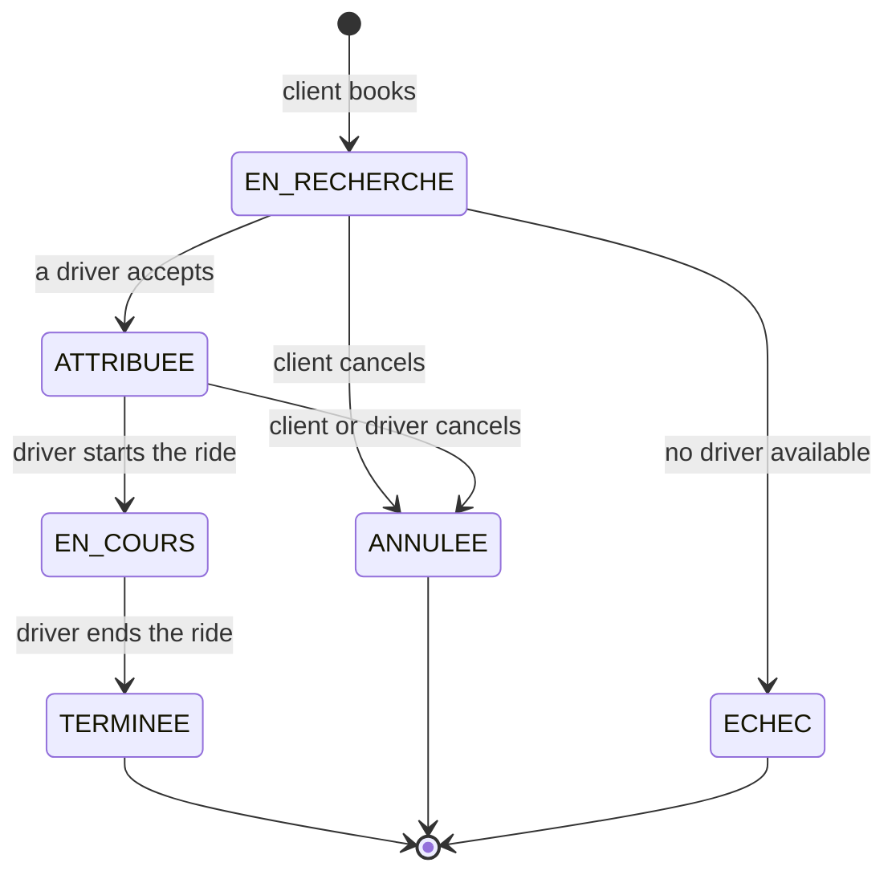
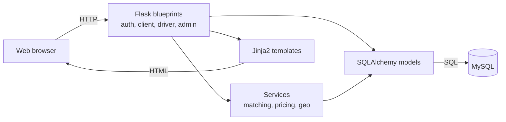
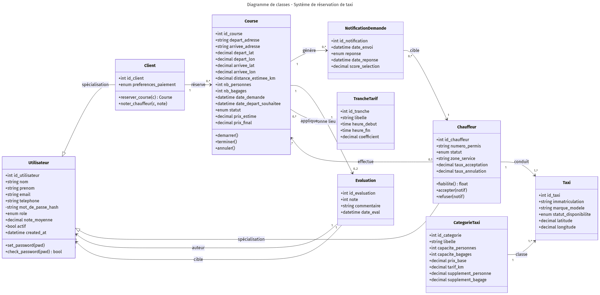

# Taxi booking platform with automatic driver matching

A full-stack web application where clients book a taxi and the system automatically
picks the most relevant driver with a weighted score. Built on my own for a software
engineering and databases course at the University of Geneva, from requirements and
UML modelling to the database schema, the Flask application and the tests.

**Stack:** Python (Flask), MySQL, SQLAlchemy, Flask-Login, bcrypt, Jinja2, Mermaid, pytest.
The code, comments and user interface are in French.

## Features

- **Three roles**: client, driver and administrator, each with their own dashboard.
- **Secure accounts**: passwords hashed with bcrypt, sessions with Flask-Login,
  role-based access control.
- **Booking with automatic pricing**: price based on the taxi category, distance,
  passengers, luggage and time of day (night rate × 1.25).
- **Address geocoding**: clients type a plain address, converted to coordinates
  with the OpenStreetMap Nominatim API.
- **Automatic driver matching** (see below).
- **Ride lifecycle** with strict state transitions, and **two-way ratings**
  (client ↔ driver) after each ride.
- **Admin dashboard**: statistics and recalculation of average ratings.

## Driver matching algorithm

When a client books a ride, `app/services/matching.py`:

1. **Filters** drivers: available, with a taxi that fits the number of passengers and
   pieces of luggage, and within the search radius of the pick-up point.
2. **Scores** each remaining driver:

   ```
   score = 0.50 × rating/5 + 0.30 × (1 − distance/radius) + 0.20 × reliability
   reliability = 0.7 × acceptance rate + 0.3 × (1 − cancellation rate)
   ```

   All three criteria are normalised to [0, 1] and the weights sum to 1, so the score
   is always between 0 and 1.
3. **Notifies** the drivers in decreasing score order. The first driver to accept gets
   the ride: the route first checks that the ride is still waiting for a driver, then
   updates the ride, the taxi and the driver and expires the other notifications in a
   single database transaction. Once a ride is assigned, the other drivers can no longer
   accept it.

| Driver profile | Rating | Distance | Accept. / Cancel. | Score |
| --- | --- | --- | --- | --- |
| Perfect | 5/5 | 0 km | 100% / 0% | 1.00 |
| Average | 4/5 | 2.5 km | 92% / 5% | 0.74 |
| Weak | 3/5 | 4.9 km | 60% / 20% | 0.44 |

*(Examples with a 5 km radius.)* Details, pseudo-code and complexity:
[`docs/ALGORITHME.md`](docs/ALGORITHME.md).

## Ride lifecycle



Every route that changes a ride checks its current state first, so a double click or a
forged request cannot skip a step.

## Architecture



- **Application factory** (`create_app()` in `app/__init__.py`), so tests can use a
  different configuration.
- **Business logic isolated** in `app/services/`, testable without the web server or
  the database.
- **Database** accessed only through the SQLAlchemy ORM; the schema is also available
  as plain SQL in `sql/01_schema.sql` (foreign keys, `CHECK` constraints, `ENUM` types,
  secondary indexes).

Six UML diagrams (use cases, classes, sequence, activity, states, components) are in
[`docs/uml/`](docs/uml/), as Mermaid sources and PNG exports.



## Run it

**Requirements:** Python 3.10+ and a MySQL server (XAMPP, MAMP, a local install, or
Docker with the provided `docker-compose.yml`).

```bash
git clone https://github.com/samy-ouali/taxi-booking-platform.git
cd taxi-booking-platform
python -m venv .venv
source .venv/bin/activate          # Windows: .venv\Scripts\activate
pip install -r requirements.txt

cp .env.example .env               # then fill in your MySQL credentials
# optional: start MySQL + phpMyAdmin with Docker
docker compose up -d

python seed.py                     # creates the tables and the demo data
python run.py                      # http://127.0.0.1:5000
```

**Demo accounts** (password `password`, test data only):

| Role | Email |
| --- | --- |
| Admin | admin@taxi.local |
| Client | alice@mail.com, bob@mail.com, camille@mail.com |
| Driver | david@taxi.com, emma@taxi.com, fabien@taxi.com, gina@taxi.com, hugo@taxi.com |

## Tests

```bash
python -m pytest
```

76 automated tests: unit tests (distance, pricing, normalisation, score), integration
tests (pricing + distance together), functional scenarios and non-regression tests.
They run without a database, thanks to the isolated services layer and mock objects.

## Possible improvements

- Use real road distances (OSRM or Google Maps) instead of a straight-line distance.
- Lock the ride row while a driver accepts (`SELECT ... FOR UPDATE`), so that two
  drivers clicking at exactly the same millisecond are also handled safely.
- Real-time notifications for drivers with WebSockets.
- Online payment and deployment behind a production WSGI server.

## Author

Samy Ouali, BSc Information Systems student at the University of Geneva.
